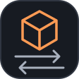
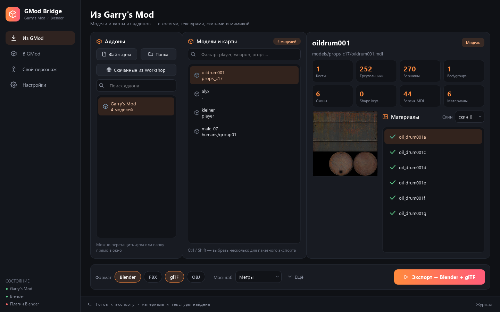

<div align="center">



# GMod Bridge

**Модели и карты Garry's Mod — в ваши 3D-проекты.**  
Экспорт в Blender, FBX, glTF и OBJ. Свои модели — обратно в игру.

<p>
  <a href="https://github.com/x-1de/gmod-bridge/releases"></a>
  <a href="https://github.com/x-1de/gmod-bridge/actions/workflows/checks.yml"></a>
  <a href="LICENSE"></a>
  
</p>

<a href="https://github.com/x-1de/gmod-bridge/releases/download/v0.2.0b1/GModBridge-0.2.0b1-windows-x64.zip"></a>

[Все релизы](https://github.com/x-1de/gmod-bridge/releases) · [Быстрый старт](#быстрый-старт) · [Возможности](#возможности) · [Сообщить об ошибке](https://github.com/x-1de/gmod-bridge/issues/new/choose)

<br>



<sub>Интерфейс на русском. На скриншоте — базовый контент Garry's Mod; игровые файлы не входят в поставку.</sub>

</div>

<br>

GMod Bridge объединяет работу с моделями Source в одном окне: откройте аддон, найдите модель или карту, выберите нужные форматы и экспортируйте. Кости, веса, UV, текстуры и мимика переносятся там, где это поддерживает выбранный формат.

> [!NOTE]
> **Первый публичный beta-релиз.** Мастер создания playermodel пока экспериментальный: автоматические веса и хват оружия могут требовать ручной правки. Проверяйте персонажа в самой игре перед публикацией аддона.

## Быстрый старт

1. **[Скачайте Windows-архив](https://github.com/x-1de/gmod-bridge/releases/download/v0.2.0b1/GModBridge-0.2.0b1-windows-x64.zip)** и распакуйте его целиком.
2. Запустите **`GModBridge.exe`**. Папку `_internal` оставьте рядом — Python отдельно устанавливать не нужно.
3. В **«Настройках»** проверьте путь к Blender и выберите папку для результатов.
4. Откройте **«Из GMod»**, загрузите аддон, выберите модель или карту и нажмите **«Экспорт»**.

| Что нужно | Для чего |
| :--- | :--- |
| **Windows 10 / 11 x64** | Запуск готовой программы |
| **Отдельно установленный Blender** | Сборка сцен и преобразование форматов. Проверялся Blender 5.2 |
| **Garry's Mod** | Контент игры, поиск зависимостей и сборка своих аддонов через `studiomdl.exe` / `gmad.exe` |

Blender, игра и инструменты Valve не включены в архив. Дополнительный аддон Blender для обычного экспорта не нужен.

<details>
<summary><b>Контрольная сумма и обновление</b></summary>

SHA-256 опубликована [рядом с Windows-архивом](https://github.com/x-1de/gmod-bridge/releases/tag/v0.2.0b1). Для проверки:

```powershell
Get-FileHash .\GModBridge-0.2.0b1-windows-x64.zip -Algorithm SHA256
```

Чтобы обновиться, закройте программу и распакуйте новый выпуск в отдельную папку. Сохраните свои исходники и результаты. После обновления установленного аддона полностью перезапустите Garry's Mod.

</details>

## Возможности

<table>
<tr>
<td width="50%" valign="top">
<h3>Из GMod → в 3D-редактор</h3>
<p>Модели из GMA, старых Workshop BIN и распакованных папок. Кости, веса, UV, материалы, скины и flex-мимика. Можно выбрать несколько форматов сразу.</p>
</td>
<td width="50%" valign="top">
<h3>Целые карты</h3>
<p>BSP-геометрия, рельеф, двери, кнопки и пропы в одной сцене. Материалы ищутся в игре, подключённых аддонах и внутри самой карты.</p>
</td>
</tr>
<tr>
<td width="50%" valign="top">
<h3>Своя модель → аддон</h3>
<p>FBX, OBJ, GLB / glTF, BLEND, STL и PLY превращаются в статичные пропы: материалы Source, физика, папка аддона и GMA для дальнейшей загрузки в Workshop.</p>
</td>
<td width="50%" valign="top">
<h3>Свой персонаж <sub>beta</sub></h3>
<p>Назначение текстур, 21 точка, виды спереди и сбоку, зум и проверка позы. Скелет ValveBiped, пальцы, стандартные анимации и рэгдолл.</p>
</td>
</tr>
</table>

**Плагин для Blender:** скины, bodygroups и слайдеры лица как в Face Poser. Установите его из настроек программы, затем откройте **3D-вид → N → GMod**. Работает с моделями, у которых есть соответствующие Source-данные.

## Какой формат выбрать

| Формат | Когда использовать | Что переносится |
| :--- | :--- | :--- |
| **BLEND** | Продолжить работу в Blender | Скелет, веса, shape keys, драйверы лица и переключение скинов |
| **FBX** | Передать персонажа в другой редактор или движок | Скелет, веса, shape keys и преобразованные материалы |
| **GLB** | Получить glTF одним файлом | Скелет, веса, morph targets и встроенные текстуры |
| **OBJ** | Нужны геометрия и материалы | Меш, UV и MTL. Без костей и мимики |

В FBX, GLB и OBJ экспортируются выбранный скин и видимые части модели. Сложные игровые шейдеры и драйверы Blender не переносятся напрямую.

> [!TIP]
> Держите `.mtl` и картинки рядом с `.obj`, а папку `textures` — рядом с экспортированной картой `.blend`. Для тяжёлых карт уменьшите текстуры до **512 / 1024** и работайте в режиме **Solid**.

## Свой персонаж за пять шагов

В текущих исходниках мастера — **27 точек**, отдельная подгонка пяти пальцев на каждой руке и опциональный **скелет из 64 костей** с костями пясти. Эти изменения появятся в следующей сборке; скачиваемый `0.2.0b1` содержит предыдущий вариант мастера. Создание персонажей остаётся **бетой**.

**Модель → Текстуры → Точки → Проверка → Сборка**

Загрузите персонажа в T- или A-позе, назначьте изображения материалам и расставьте суставы на двух видах. После проверки тестовой позы выберите мужские или женские анимации и соберите аддон. В игре персонаж появится в **C → Player Model**.

| Управление точками | Действие |
| :--- | :--- |
| Колесо мыши | Приближение к курсору |
| Правая / средняя кнопка | Перемещение изображения |
| Двойной клик / «Вписать» | Вернуть общий вид |
| Стрелки | Точный сдвиг выбранной точки |
| Shift + стрелки | Ускоренный сдвиг |

Качество весов зависит от геометрии, одежды, позы и расположения точек. В игре проверьте стойку, бег, присед, пистолет, SMG, лом и падение после смерти. Совпадение имён костей само по себе не гарантирует правильную анимацию.

## Вопросы и проблемы

<details>
<summary><b>Почему нет текстур или видны фиолетовые клетки?</b></summary>

У Source-моделей материалы часто лежат в другом аддоне или в базовой игре. Проверьте зависимости и журнал. В мастере персонажа изображения можно назначить каждому материалу вручную или подобрать из папки по именам.

</details>

<details>
<summary><b>Почему карта выглядит полой или тормозит?</b></summary>

Компилятор Source удаляет невидимые внешние грани, поэтому карта снаружи может выглядеть полой. Это ограничение исходного BSP.

Производительность зависит от числа объектов, прозрачных материалов и видеопамяти. Уменьшите текстуры до 512 / 1024, отключите свет карты и используйте Solid. Свет, вода, небо и материалы переносятся приблизительно; полноценного переноса лайтмапов и декалей пока нет.

</details>

<details>
<summary><b>Можно ли перенести готовые анимации и лицо?</b></summary>

Импорт sequences пока не реализован. У Source-моделей переносятся flex → shape keys и имеющиеся flex-контроллеры. Произвольной модели мастер не генерирует мимику, jigglebones и собственные руки от первого лица — используются стандартные руки игры. В мастере готовый скелет заменяется новым.

</details>

<details>
<summary><b>Где результаты, рабочие файлы и журнал?</b></summary>

Папка результатов выбирается в настройках. Рабочие файлы новых персонажей сохраняются в `Documents/GMod2Blender/projects/<id>/` и не удаляются очисткой временных файлов Windows. Старые сессии ранних версий могут оставаться в `%TEMP%`. Автоматического восстановления мастера через интерфейс пока нет.

Журнал: `%LOCALAPPDATA%/GModBridge/logs/bridge.log`.

</details>

**Не нашли решение?** [Создайте issue](https://github.com/x-1de/gmod-bridge/issues/new/choose): укажите версии программы и Blender, формат исходника, шаги и приложите журнал. Для проблем с ригом нужны виды точек спереди / сбоку и результат в игре. Удалите личные пути из журнала перед отправкой.

## Для разработчиков

<details>
<summary><b>Запуск из исходников · Python 3.11+</b></summary>

```powershell
git clone https://github.com/x-1de/gmod-bridge.git
cd gmod-bridge
py -m venv .venv
.venv\Scripts\python.exe -m pip install -e ".[dev]"
.venv\Scripts\python.exe -m gm2b
```

Скрипты с `bpy` выполняются внутри Blender, а не обычным Python.

</details>

<details>
<summary><b>Консольный экспорт</b></summary>

```powershell
gmod-bridge-cli addon.gma
gmod-bridge-cli addon.gma models/example.mdl --out out --format blend --format glb
gmod-bridge-cli addon.gma maps/example.bsp --out out --format obj --max-texture 512
```

Если автоматический поиск не сработал, укажите `--blender C:\path\to\blender.exe` и `--gmod C:\path\to\GarrysMod`.

</details>

<details>
<summary><b>Проверки и Windows-сборка</b></summary>

```powershell
.venv\Scripts\python.exe -m unittest discover -s tests -v
.venv\Scripts\python.exe -m ruff check gm2b tests scripts
.venv\Scripts\python.exe scripts/smoke_gui.py
.venv\Scripts\python.exe scripts/build_release.py
```

Результат — ZIP и SHA-256 в `dist/`. GitHub Actions проверяет исходники на Python 3.11 / 3.13. Игровые тесты выполняются отдельно. Сборку можно запустить через **Actions → Build release** или отправкой тега `v*`.

</details>

[Как внести вклад](CONTRIBUTING.md) · [История изменений](CHANGELOG.md) · [Сторонние компоненты](THIRD_PARTY.md)

## Лицензия

Код распространяется по **[MIT](LICENSE)**. Модели, карты и текстуры остаются собственностью их авторов и не входят в поставку. Для распространения конвертированного контента нужны соответствующие права.

---

<div align="center">

**Есть полезный пример или нашли ошибку? [Расскажите в Issues](https://github.com/x-1de/gmod-bridge/issues).**  
Если программа пригодилась — поддержите проект звездой на GitHub.

</div>
